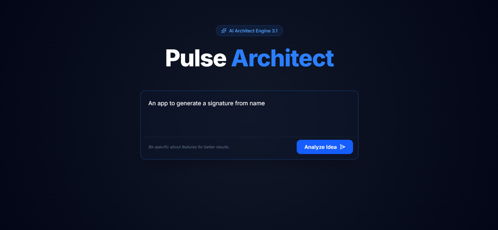
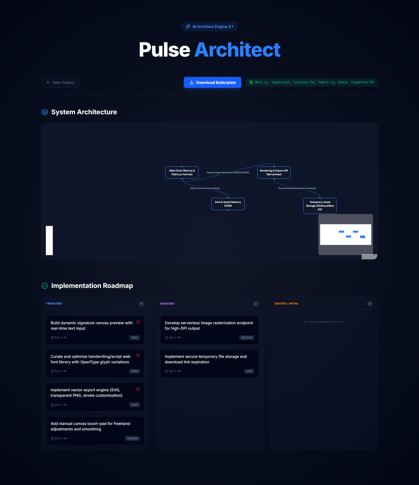

# Pulse Architect - AI Hackathon Idea Scaffolder

Type a one-line product idea and get a starting plan for it: an interactive system-architecture diagram, a prioritized task board split by role, and a suggested tech stack. You can also download a minimal starter project as a ZIP.

**Live demo:** https://pulse-architect-two.vercel.app





## What it does

1. You describe an idea, for example "An app to generate a signature from name".
2. The app asks the Gemini API for a structured plan as JSON.
3. The result is shown as:
   - **System architecture:** an interactive node-and-edge diagram built with React Flow.
   - **Implementation roadmap:** tasks grouped by role (Frontend, Backend, DevOps) with a priority on each.
   - **Suggested stack:** shown as a tag next to the download button.
4. **Download Boilerplate** returns a ZIP with a `README.md`, a minimal `package.json` and an empty `src/app` and `src/components` folder structure.

## Tech stack

Next.js (App Router), React, TypeScript (strict mode), Tailwind CSS, React Flow, Google Generative AI SDK (`gemini-flash-latest`), `archiver` for the ZIP, Lucide icons. Deployed on Vercel, which redeploys automatically on each push to GitHub.

## How it works

```
Idea (text)
   |
   v
POST /api/generate        prompts Gemini for a JSON plan, extracts and parses the JSON
   |  { projectName, architecture{nodes, edges}, tasks[], suggestedStack }
   v
React UI                  ArchitectureDiagram (React Flow) + TaskBoard
   |
   v
POST /api/generate-zip    builds a ZIP with archiver and streams it to the browser
```

## API routes

| Route | Body | Returns |
|---|---|---|
| `POST /api/generate` | `{ "prompt": "your idea" }` | JSON plan: `projectName`, `architecture` (nodes, edges), `tasks` (title, priority, role), `suggestedStack` |
| `POST /api/generate-zip` | `{ "projectName": "...", "suggestedStack": "..." }` | A ZIP file download |

## Run locally

Requires Node.js 20 or newer.

```bash
git clone https://github.com/spandanareddib/pulse-architect.git
cd pulse-architect
npm install
```

Create a `.env.local` file in the project root:

```
GEMINI_API_KEY=your-key-here
```

You can get a key from Google AI Studio. Then start the dev server:

```bash
npm run dev
```

Open http://localhost:3000.

## Project structure

```
src/
  app/
    page.tsx                 Main page and download handler
    layout.tsx
    api/
      generate/route.ts      Gemini call and JSON parsing
      generate-zip/route.ts  Starter-project ZIP
  components/
    IdeaForm.tsx             Idea input and request to /api/generate
    ArchitectureDiagram.tsx  React Flow diagram
    TaskBoard.tsx            Roadmap columns by role
```

## Known limitations

- **AI output varies.** The plan is generated by a language model, so treat it as a starting point and review it. The server extracts the JSON from the model's text, and occasionally a malformed response returns an error.
- **Waits for the full answer.** The plan is requested in one call and shown when complete. Only the ZIP download is streamed.
- **Free API quota.** The live demo depends on a Gemini API key with limited quota, so it can stop responding if the quota runs out.
- **Minimal starter ZIP.** The download is a skeleton (README, `package.json`, folders), not a generated application.
- **Loose typing.** The API response is currently handled as `any` on the client. Adding shared TypeScript types and a schema check is a planned improvement.

## Possible next steps

- Add typed response schemas and validation for the model output.
- Stream the plan to the UI as it is generated.
- Generate richer starter files that match the suggested stack.
- Add tests and a CI workflow.
